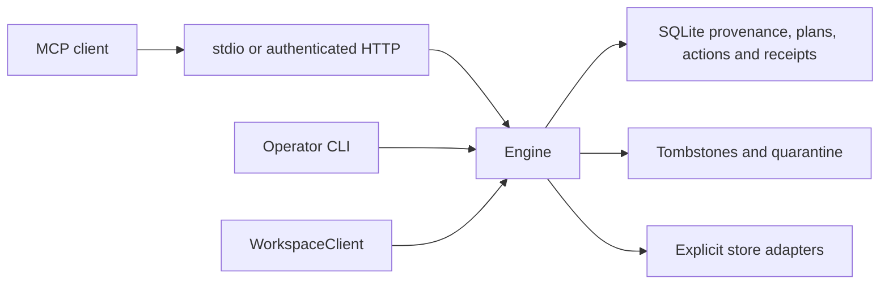

# Architecture

`Engine` contains policy shared by the MCP server, operator CLI and application API.
Configuration fixes reachable store scope; a client request cannot add stores.

1. Discovery records fingerprints, capabilities and candidate relationships. Known
   provenance is distinct from inferred similarity. Scan/trace/plan can write graph
   metadata; they do not edit source-store content.
2. Planning creates concrete actions with expected fingerprints, scope and a plan
   hash. Review edits bump the version and invalidate previous approval tokens.
3. Operator approval issues a short-lived single-use token. MCP has no approval tool.
4. Apply checks authorization, fingerprints and adapter support. Completed actions
   have idempotency records; failures and unavailable stores remain visible.
5. Verification rescans its reachable scope, assesses residual disclosures, and
   signs a receipt. The signature protects integrity with retained keys, not physical
   overwrite or truth of source data.
6. Tombstones gate application admission. Suspected replays can be quarantined.
   Direct store access remains possible; retrieval/reconciliation provide additional
   scoped checks rather than universal enforcement.

Core modules: `config`/`profiles` resolve immutable scope; `connectivity` exports and
registers client entries; `engine` coordinates policy; `graph` persists provenance
and action state; `discovery` scores candidates; `policy` authorizes actions;
`adapters` mutate supported stores; `workspace` integrates application writes/reads.

Participating local processes share OS/thread locks. A local lock is not a distributed
transaction. Chroma and independently written files have separate mutation boundaries;
non-cooperating writers and crashes remain important verification cases.
