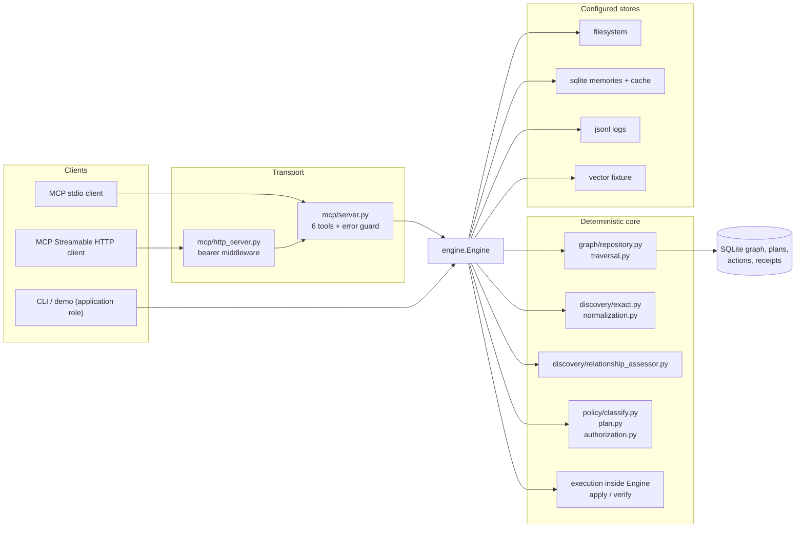
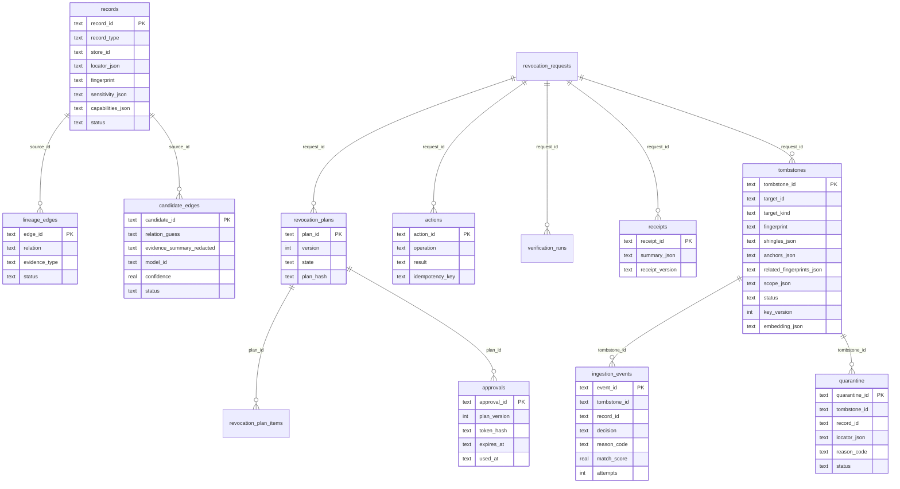
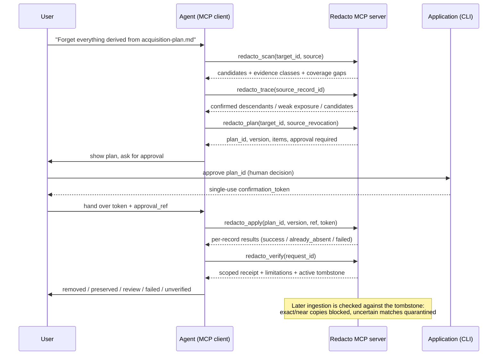
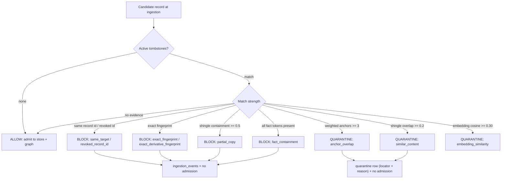
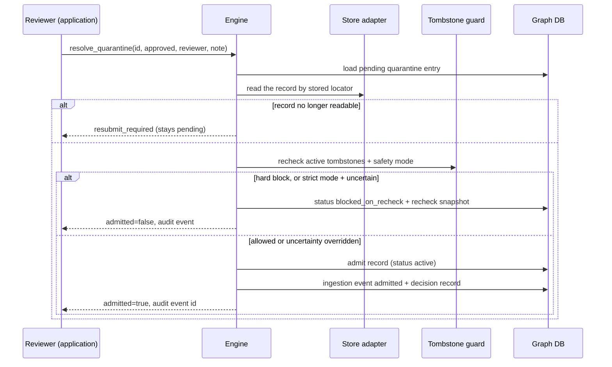

# Redacto architecture

## Shape

Redacto is a small Python service with one engine and two transport adapters. Every
tool call — from MCP, the CLI or the demo — goes through `redacto.engine.Engine`,
so scope checks, policy and authorization cannot be bypassed by picking a
different entry point.

## Module map

| Module | Responsibility |
|---|---|
| `config.py` | Explicit settings from environment; no discovery of scope at runtime. |
| `fixtures.py` | Synthetic workspace + graph seed shared by demo, CLI and tests. |
| `graph/schema.py`, `graph/repository.py` | SQLite tables and all persistence. |
| `graph/traversal.py` | Bounded BFS. Strong-only paths become confirmed descendants; `READ_FROM` becomes exposure. |
| `discovery/normalization.py` | Normalization variants and keyed HMAC fingerprints. |
| `discovery/exact.py` | Whole-document matching for sources, bounded substring matching for facts/secrets, entity heuristic. |
| `discovery/relationship_assessor.py` | Replaceable assessor: `NullAssessor` default, OpenAI-compatible implementation, strict Pydantic schema, unassessed on any failure. |
| `policy/classify.py` | Evidence classes → proposed action + approved flag + collateral risk. |
| `policy/plan.py` | Plan items, version-bound plan hash, estimated impact. |
| `policy/authorization.py` | Application-issued confirmation tokens (hash stored, short TTL, single use). |
| `ingestion.py` | Tombstone material, guard evaluation, and the allowed/quarantined/blocked decision. |
| `discovery/embeddings.py` | Local deterministic embedding provider, cosine scoring, and labelled calibration. |
| `engine.py` | scan / trace / plan / apply / verify orchestration and all scope checks. |
| `receipts.py` | Receipt rendering to JSON and Markdown. |
| `mcp/server.py` | Tool registration plus the error guard that never leaks stack traces. |
| `mcp/stdio_server.py`, `mcp/http_server.py` | The two transports. |
| `cli.py` | Terminal application: seed, plan, approve, apply, verify, demo. |

## Data model

No table stores record content, matched passages, secrets or model prompts. Only
opaque locators, keyed fingerprints, booleans and redacted reason strings.

## Flow: source revocation

## Execution semantics

- **Actions**: `DELETE_RECORD`, `INVALIDATE_INDEX`, `INVALIDATE_CACHE`,
  `REDACT_SPAN` (only where an adapter advertises redaction), `REVIEW_REQUIRED`,
  `SKIP_PRESERVE`, `UNREACHABLE`.
- **Plan states**: `READY_FOR_APPROVAL → APPROVED → EXECUTING → VERIFYING →
  VERIFIED_WITHIN_SCOPE`, with `PARTIAL`, `NEEDS_REVIEW`, `FAILED` as honest
  exceptional states.
- **Idempotency**: each action has a unique key. A dry run writes keys prefixed
  `dryrun:` so a later real apply still executes. Re-applying an applied plan
  returns `already_completed` with the recorded results instead of repeating work.
- **Verification**: rescan reachable in-scope stores, check planned record IDs and
  the keyed whole-target fingerprint, and report residuals. Unreachable stores are
  reported as gaps, never as clean.

## Revocation tombstones and the ingestion guard

A verified revocation writes one tombstone per request. It stores the target's keyed
HMAC fingerprint, keyed hashes of normalized 5-word shingles, weighted anchor hashes
(proper nouns weight 1, numeric amounts weight 2), token hashes for fact/secret
targets, the removed records' fingerprints, a derived embedding vector, the key
version that produced the material, scope, policy and status. The revoked content is
not stored and cannot be recovered from the tombstone.

Blocked records never enter the store or the graph. Quarantined records are held as a
review pointer and also not admitted. Neither is deleted automatically: a record that
already exists in a store stays there and is reported, preserving the approval
boundary.

Embedding similarity is a **risk signal only**: it can quarantine, never block and
never confirm lineage. Thresholds are calibrated on a labelled synthetic set (see
`redacto calibrate-embeddings`); the local provider is a deterministic lexical-semantic
embedding, not a neural model.

The same guard runs inside `redacto_scan`, so restoring a revoked file cannot
re-admit it to the provenance graph. Records already active in the graph are exempt
from the admission guard so a later revocation can still target them, while restored
or never-admitted records are guarded. `redacto ingest` re-runs the guard over the
configured stores and reports `allowed`, `blocked` and `quarantined` counts.

## Quarantine resolution

Quarantine is a review queue. Resolution is an application action, not an MCP tool.

Rejection records the decision, reviewer, note and recheck snapshot without admitting
the record. Neither path deletes content. An approval can override **uncertainty**;
it can never override a hard tombstone block, which is what stops a previously
reviewed record from being used to bypass a later revocation.

## Key rotation

Tombstones carry a `key_version`. The guard evaluates each tombstone with that
version's key from `REDACTO_HMAC_KEYS`. Missing versions fail closed for ingestion;
missing current versions refuse new work; verification reports `not_verifiable` when
the target's key version is gone. Full procedure: [key-rotation.md](key-rotation.md).

## Transport

- **stdio** (`redacto-stdio`): used by local MCP clients.
- **Streamable HTTP** (`redacto-http`): bearer-token middleware in front of the same
  server; refuses to start without `REDACTO_HTTP_TOKEN`; localhost bind by default.

Both transports call the identical engine and tool functions.